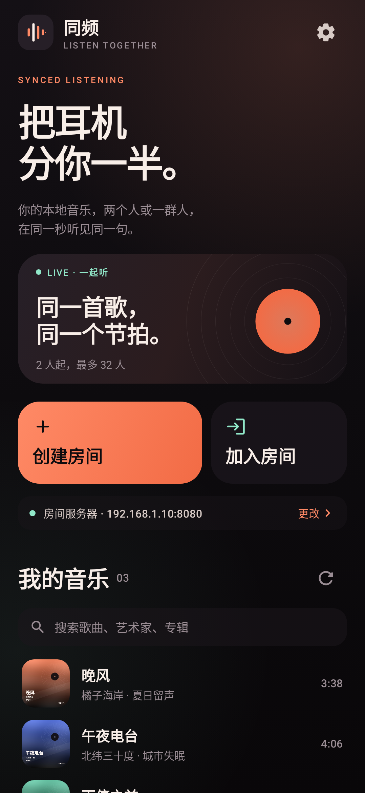
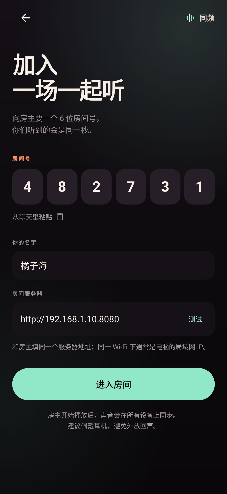
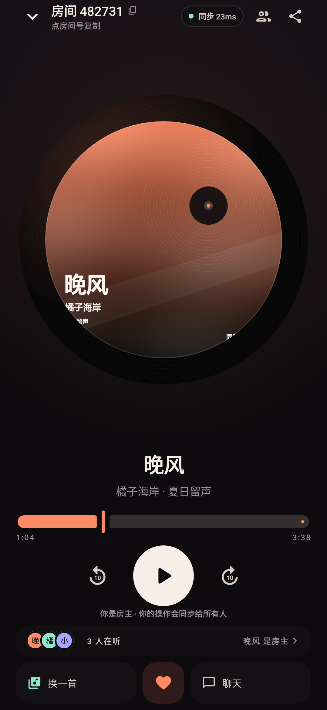

# 同频 · Tongpin / With Sounds

> 把耳机分你一半。

一个 Android 上的「本地音乐一起听」应用。仓库名 `with-sounds`，中文产品名「同频」。房主从手机里选一首本地歌曲，上传到房间服务器；房间里的所有人（2～32 人）通过同一个 HTTP 音频流收听，由服务器时间轴统一调度播放进度。每个人听到的是同一秒，不是各播各的。



| 加入房间 | 房间 |
| --- | --- |
|  |  |

> 以上是 Compose 界面在 Robolectric 中按 411 × 891 dp 渲染的预览，安装到真机后状态栏、字体和封面加载会略有差异。

---

## 功能

- **扫描本地音乐**：通过 MediaStore 读取手机里的 MP3 / FLAC / OGG / Opus / M4A / WAV，展示标题、艺术家、专辑、时长和封面；只读，不修改原文件。
- **创建房间**：选一首本地歌 → 创建 6 位房间号 → 音乐自动上传到房间服务器。
- **加入房间**：输入房间号和同一个服务器地址即可。支持昵称、剪贴板粘贴房间号。
- **多人同步播放**：服务器给出统一的 `startAt`，所有设备（包括房主）播放同一个 HTTP 流；客户端用 WebSocket 时间采样校正时钟，播放中持续做漂移修正。
- **房主控制**：播放 / 暂停 / 拖动进度 / 前后 10 秒 / 中途换歌；听众端只读，但可以聊天和发爱心。
- **房间社交**：实时聊天、爱心/火焰/鼓掌等表情、成员列表、在线人数、同步延迟指示。
- **房主离开保护**：房主断开时服务器暂停播放并通知所有人；房间保留 10 分钟。
- **前后台保活**：进入房间后启动 `mediaPlayback` 前台服务，切到后台或锁屏时音乐继续；房间页保持屏幕常亮。
- **无需账号**：没有注册、登录、云端音乐库；房间号就是入场凭证。
- **零依赖服务器**：`server/server.js` 只用 Node 内置模块，不需要 `npm install`；支持 HTTP Range（拖动进度）、WebSocket、可选 HTTPS。

## 它怎么工作

```text
 房主手机                          房间服务器                         听众手机
┌──────────┐   1. 上传音频   ┌──────────────────┐   3. WebSocket   ┌──────────┐
│ 本地音乐  │ ─────────────▶ │ 内存房间 + 音频文件 │ ◀────────────── │  同频 App │
│ ExoPlayer│   2. 创建房间   │ HTTP Range + WS   │   4. 同步播放     │ ExoPlayer│
└──────────┘                 └──────────────────┘                  └──────────┘
         ▲                            │                                   ▲
         └──────── 所有人播放同一个 HTTP 流，按服务器时间轴对齐 ────────────┘
```

一次「一起听」的过程：

1. App 调 `POST /api/rooms` 拿到 6 位房间号和房主令牌。
2. 房主把选中的歌 `POST` 到 `/api/rooms/:code/track`；服务器落盘并广播曲目信息。
3. 所有人（包括房主）用 ExoPlayer 播放 `GET /api/rooms/:code/audio`，服务器支持 `Range`，所以可以秒拖进度。
4. 房主点播放时，服务器广播 `{playing:true, positionMs, startAt: serverNow + 1100ms}`。
5. 客户端连接后发送 6 次 `{type:"time"}` 采样 RTT，取最优样本计算 `serverNow = 本机时钟 + offset`；在 `startAt` 前调度播放。
6. 播放中每 250ms 比较一次“本地实际位置”和“服务器目标位置”：
   - 偏差 > 900ms：直接 seek；
   - 偏差 140～900ms：用 ±4% 的播放速率慢慢追；
   - 偏差 < 140ms：恢复 1.0 倍速。

因为房主也播放服务器上的同一个流，而不是本地文件，所以不存在“房主即时出声、听众晚半秒”的结构性问题。1.1 秒的预缓冲让所有人有同样的起跑线。

## 快速开始（同一 Wi-Fi）

### 1. 启动房间服务器

需要电脑上有 **Node.js 18+**（[nodejs.org](https://nodejs.org/)）。

- Windows：双击项目根目录的 **`启动同频服务器.bat`**。
- 或者命令行：

```bash
cd server
node server.js 8080
```

启动后终端会打印本机和局域网地址，例如：

```text
本机:   http://127.0.0.1:8080
局域网: http://192.168.1.10:8080
```

第一次启动时 Windows 会弹防火墙提示，请允许 **Node.js 访问专用网络**。手机和电脑必须在同一个 Wi-Fi，且路由器没有开启 AP 隔离。

### 2. 安装 App

```text
dist/tongpin-1.0.0.apk
```

Android 8.0（API 26）及以上。安装时允许「安装未知来源应用」，首次打开允许读取音频。

### 3. 设置服务器

首页 → 右上角齿轮 → 填：

```text
http://192.168.1.10:8080
```

点「测试」，看到“已连接”即可。两台手机都要填同一个地址。

### 4. 开一场

- 房主：首页 →「创建房间」→ 选歌 → 确认昵称和服务器 →「开始一起听」。房间号会显示在房间页顶部，点一下复制，或点分享发朋友。
- 听众：首页 →「加入房间」→ 填 6 位房间号、昵称、同一个服务器地址 → 进入。

房主按播放，所有人会在约 1.1 秒后一起开始。

## 异地 / 公网使用

服务器并不要求手机和电脑在同一局域网。把 `server/` 部署到一台有公网 IP 的机器，App 里填公网地址即可。

### 方式 A：Docker Compose（推荐）

```bash
docker compose up -d --build
```

默认监听 `8080`，音频数据保存在 Docker volume `tongpin-data` 里。然后在 App 里填：

```text
http://你的服务器IP:8080
```

### 方式 B：VPS + 域名 + HTTPS

1. 把 `server/` 传到服务器，运行 `node server.js 8080`（建议用 systemd / pm2 守护）。
2. 用 Caddy 反向代理，`Caddyfile` 参考 [Caddyfile.example](Caddyfile.example)：

```caddyfile
music.example.com {
    reverse_proxy 127.0.0.1:8080
}
```

3. 放行 80/443，App 里填 `https://music.example.com`。

Caddy 会自动申请证书，并转发 WebSocket Upgrade。也可以使用 Nginx：

```nginx
location / {
    proxy_pass http://127.0.0.1:8080;
    proxy_http_version 1.1;
    proxy_set_header Upgrade $http_upgrade;
    proxy_set_header Connection "upgrade";
    proxy_set_header Host $host;
    client_max_body_size 320m;
    proxy_read_timeout 3600s;
}
```

### 方式 C：临时公网隧道

如果只是临时和朋友听一场，电脑上运行服务器后，再开一个 Cloudflare Tunnel：

```bash
cloudflared tunnel --url http://localhost:8080
```

把生成的 `https://xxxx.trycloudflare.com` 填进 App。隧道关闭后地址失效。

> 公网部署时建议一定上 HTTPS。房间号是唯一门槛，别把服务器当成公开网盘；音频接口只知道房间号就能读。房间空闲 10 分钟或存在超过 12 小时会自动清理。

## 构建

要求：

- JDK 17
- Android SDK **Platform 36 / Build-Tools 35+**
- Android Studio 或命令行 Gradle

```bash
cd tongpin
./gradlew assembleDebug
```

产物：

```text
app/build/outputs/apk/debug/app-debug.apk
```

`local.properties` 里写本机 SDK 路径：

```properties
sdk.dir=C\:\\Android\\Sdk
```

依赖仓库优先使用阿里云镜像（`settings.gradle.kts`），官方 Google / Maven Central 作为回退。

`dist/tongpin-1.0.0.apk` 是可直接安装的 **debug 签名** 构建，适合侧载测试；上架应用商店前请用自己的 release keystore 重新签名。

界面预览可以重新生成：

```bash
./gradlew :app:testDebugUnitTest --tests 'com.tongpin.app.ScreenshotTest'
```

截图输出在 `docs/screenshots/`。首次运行会下载 Robolectric 的 Android 运行时（约 200MB）。

### 服务器测试

```bash
cd server
node --check server.js
node server.js 18080
# 另开一个终端
python test_e2e.py
```

`test_e2e.py` 会真实创建房间、上传音频/封面、验证 Range（含 suffix range）、两个 WebSocket 客户端、时钟、播放、聊天、表情和暂停。它需要 Python 3 和 Pillow。

## 项目结构

```text
tongpin/
├── app/src/main/java/com/tongpin/app/
│   ├── MainActivity.kt               # 权限、深链、入口
│   ├── MainViewModel.kt              # 页面状态、创建/加入、会话生命周期
│   ├── data/
│   │   ├── MusicRepository.kt        # MediaStore 扫描 + 封面提取
│   │   ├── RelayApi.kt               # HTTP 上传 / Range / WebSocket 建连
│   │   ├── RoomSession.kt            # 房间状态机、时钟同步、聊天
│   │   └── Models.kt
│   ├── playback/
│   │   ├── PlaybackEngine.kt         # ExoPlayer + 漂移修正
│   │   └── RoomPlaybackService.kt    # 前台保活通知
│   └── ui/                           # Compose 界面
├── server/
│   ├── server.js                     # 零依赖 HTTP + WebSocket 服务器
│   ├── test_e2e.py
│   └── Dockerfile
├── demo-music/                       # 全合成测试音乐（无版权问题）
├── tools/
├── 启动同频服务器.bat
└── docker-compose.yml
```

## 已知边界

- **一次只放一首**。换歌会重新上传并从头开始，没有播放队列。这是刻意的 v1 范围。
- **房间在内存里**。服务器重启后房间消失；音频文件随房间清理。
- **上传是同步的**。创建/换歌时会显示上传进度，大文件在慢网络下需要等一会儿。服务器默认单曲上限 300MB。
- **房主是唯一控制端**。没有“移交房主”或多人同时控制。房主断开后房间暂停并保留 10 分钟。
- **没有账号体系**。换设备不会恢复历史；房间号泄露等于房间可进入。
- 部分国产系统的省电策略可能杀掉后台进程；房间页保持屏幕常亮，锁屏后由前台服务尽量保活。
- 本地 Wi-Fi 模式使用 HTTP（Android 已允许明文流量），公网部署请使用 HTTPS。

## 隐私

- App 只读取系统媒体库中的音频元数据和封面，不修改文件。
- 只有房主选中的那首歌会被上传到你配置的服务器；其他歌曲不会离开手机。
- 服务器不记录账号，只保留房间、成员昵称（内存）、最近 80 条聊天（内存）和音频临时文件。
- `demo-music/` 里的 6 首歌由 `tools/make_demo_music.py` 用正弦波合成，仅用于测试和截图。
